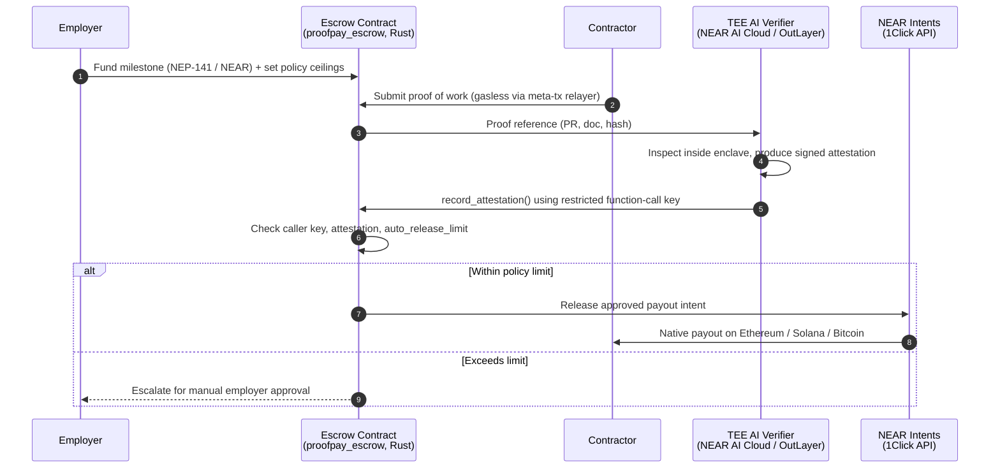

<div align="center">

# 🛡️ ProofPay

### Money moves only when work is proven.
**Non-custodial milestone escrow and cross-chain contractor payroll, with an AI verifier that can never touch your funds.**

[](#)
[](#hackathon-track-alignment)
[](#)
[](#)
[](#license)


</div>

---

## ⚡ TL;DR

| | |
|---|---|
| **Problem** | Paying international contractors takes 3–7 days and costs real fees. Letting an AI agent automate it means handing an LLM your keys. |
| **Solution** | An escrow contract on NEAR where a **TEE-hosted AI verifier** can *only* record attestations. It has **no cryptographic authority to move funds**. Payouts settle on the contractor's chain of choice via **NEAR Intents**. |
| **Why it's different** | We don't ask you to *trust* the AI. We make it **structurally incapable** of stealing. |
| **Try it in 30 seconds** | `npm run test:demo` |

---

## 🎯 The Problem

**1. Global B2B settlement is slow and expensive.**
International freelance and contractor payouts still suffer 3–7 day banking delays, stacked intermediary wire fees, and manual accounting reconciliation.

**2. Autonomous payment agents are a security disaster waiting to happen.**
Most "AI-powered payment" designs give an LLM direct access to a wallet key or an unconstrained spending authority. One successful prompt injection and the treasury is drained.

> Teams are forced to choose between *slow-and-safe* (humans approving everything) and *fast-and-dangerous* (AI with keys).
> **ProofPay removes that trade-off.**

---

## 💡 The Solution

ProofPay separates **judgment** from **authority**:

- 🧠 **The AI decides *whether work is done*.** It runs inside a hardware enclave (TEE) and inspects PRs, documents, and file hashes.
- 🔐 **The smart contract decides *what is allowed to happen*.** It enforces policy ceilings and key permissions onchain.
- 🌉 **NEAR Intents moves the money.** The contractor is paid natively on Ethereum, Solana, or Bitcoin with no manual bridging.

Even a fully compromised, jailbroken verifier can do exactly one thing: **submit an attestation**. It cannot withdraw, transfer, or reassign ownership.

---

## 🏗️ Architecture



### The Four Layers

| # | Layer | Responsibility | Key Primitive |
|---|-------|----------------|---------------|
| 1 | **Milestone Vault** | Non-custodial locking of funds, onchain policy ceilings (e.g. $1,000 auto-approve) | NEAR Rust smart contract, NEP-141 |
| 2 | **TEE AI Verifier** | Inspect deliverables, issue hardware-signed attestations | NEAR AI Cloud / OutLayer, Intel TDX / AMD SEV-SNP |
| 3 | **Policy Guard** | Restrict what the verifier can call; enforce limits | NEAR Function-Call Access Keys |
| 4 | **Settlement Layer** | Cross-chain payout to contractor's preferred chain | NEAR Intents (1Click API) |

---

## 🔒 Security Model

The core design principle: **the AI has opinions, not authority.**

| Threat | Mitigation |
|--------|------------|
| **Prompt injection against the verifier** | The verifier's access key is a **function-call key scoped to `record_attestation()` on the escrow contract only**. No `transfer`, `withdraw`, or ownership methods are callable with it. |
| **Compromised or rogue verifier** | Worst case is a bad attestation, which is still bounded by the onchain `auto_release_limit` and daily caps. Larger releases require employer approval. |
| **Over-budget release attempts** | Contract panics with `PolicyLimitExceeded`. Try it in the Attack Sandbox. |
| **Leaking client IP / proprietary code** | Inspection happens inside a hardware enclave; only the attestation leaves it. |
| **Custodial risk** | Funds sit in the contract. ProofPay operators hold no keys to employer funds. |
| **Unattested release** | Release logic requires a recorded attestation; there is no code path that pays without one. |

### 🧨 Simulate Rogue AI Attack (interactive sandbox)

The frontend includes a sandbox where you play the attacker. Instruct the AI to drain the vault, then watch the chain refuse:

```
> AI attempts withdraw(50,000 USDC)
✗ Panic: PolicyLimitExceeded
  caller_key: ed25519:AIverifier…   allowed_methods: [record_attestation]
```

---

## ✨ Features

- **Non-custodial milestone vaults** with funds locked in `proofpay_escrow` until conditions are validated
- **Policy guardrails** with single-transaction ceilings and daily expenditure caps, enforced onchain
- **TEE-based verification** of GitHub PRs, documents, and file hashes with private, tamper-evident attestations
- **Cross-chain payouts** where employers fund on NEAR or Ethereum and contractors receive on Ethereum (USDC), Solana (SOL), or Bitcoin
- **Gasless contractor experience** via NEP-366 meta-transaction relayers; freelancers never need NEAR for gas
- **Accountant-ready exports**: General-Ledger CSV (Gross, Gas Fees, Net, Intent Tx Hashes) compatible with QuickBooks and Xero
- **Selective-disclosure receipts** for tax verification without exposing the full payment history
- **Rogue AI attack sandbox** to show the security model rather than just describe it

---

## 🧰 Tech Stack

| Area | Technology |
|------|-----------|
| Smart contract | Rust, `near-sdk-rs` |
| Settlement | NEAR Intents, 1Click API |
| AI verification | NEAR AI Cloud, OutLayer (TEE) |
| Access control | NEAR Function-Call Access Keys |
| Gasless UX | NEP-366 Meta Transactions + relayer |
| Tokens | Native NEAR, NEP-141 |
| Frontend | TypeScript, React / Next.js *(adjust to your stack)* |
| Testing | `near-workspaces`, headless CLI demo suite |

---

## 🚀 Quick Start

### Prerequisites

- Node.js 18+
- Rust (stable) with the `wasm32-unknown-unknown` target
- NEAR CLI and a NEAR testnet account

### Install & run the demo

```bash
git clone https://github.com/<your-org>/proofpay.git
cd proofpay
npm install

# End-to-end headless demo (completes in under 30 seconds)
npm run test:demo
```

### Run the full app locally

```bash
cp .env.example .env        # add NEAR account, relayer key, 1Click API key
npm run build:contract      # compiles proofpay_escrow to wasm
npm run deploy:testnet      # deploys the contract
npm run dev                 # starts the frontend on http://localhost:3000
```

### What `npm run test:demo` does

1. Deploys the escrow contract to a sandbox
2. Employer funds a milestone with a policy ceiling
3. Contractor submits proof
4. Verifier records an attestation with its restricted key
5. Payout intent is released and a settlement hash is recorded
6. **Rogue attempt:** the same key tries `withdraw()` and is rejected
7. **Over-limit attempt:** release above ceiling panics with `PolicyLimitExceeded`
8. CSV export is generated and validated

---

## 📜 Contract Interface

| Method | Caller | Purpose |
|--------|--------|---------|
| `create_milestone(...)` | Employer | Lock funds and define conditions and policy limits |
| `submit_proof(milestone_id, proof_ref)` | Contractor (relayed) | Submit deliverable for verification |
| `record_attestation(milestone_id, attestation)` | Verifier (restricted key) | Record a TEE-signed result. **The only method the verifier key can call.** |
| `approve_release(milestone_id)` | Employer | Manually approve releases above the auto-release limit |
| `set_policy(auto_release_limit, daily_cap)` | Employer | Update guardrails |
| `refund(milestone_id)` | Employer | Reclaim funds on unresolved or expired milestones |

> Names reflect the intended interface. Update this table to match your deployed contract.

### Granting the verifier its restricted key

```bash
near add-key <escrow-account> <verifier-public-key> \
  --contract-id <escrow-account> \
  --method-names record_attestation \
  --allowance 0.25
```

This is the entire trust boundary: the key is scoped to one contract and one method.

---

## 📁 Repository Structure

> Adjust to match your actual layout.

```
proofpay/
├── contracts/
│   └── proofpay_escrow/       # Rust smart contract
├── verifier/                  # TEE verifier service (NEAR AI Cloud / OutLayer)
├── relayer/                   # NEP-366 meta-transaction relayer
├── app/                       # Frontend + Rogue AI Attack Sandbox
├── scripts/                   # Deployment and key provisioning
├── tests/                     # Integration tests + test:demo suite
└── docs/                      # Architecture notes, threat model
```

---

## 🏆 Hackathon Track Alignment

**Primary track: `realworld` (Real-World Money)**

| Track | How ProofPay fits |
|-------|-------------------|
| **Real-World Money** | Solves cross-border contractor settlement with stablecoin payouts and accounting-ready exports |
| **Agents** | An AI agent performs real verification work with bounded, auditable authority |
| **Security** | Policy-bounded keys remove an entire class of agent-custody attacks |
| **Business** | Targets B2B invoicing, payroll, and international contractor management |
| **Privacy** | TEE inspection keeps client data confidential; selective-disclosure receipts |

### Judging criteria

| Criterion | Our approach |
|-----------|--------------|
| **Technical implementation** | Rust contract using native NEAR access-key permissions, 1Click Intents integration, TEE attestation verification |
| **Originality & security** | Separates AI reasoning from execution authority with policy-bounded keys |
| **Real-world utility** | Immediate value for global contractor management and multi-chain B2B invoicing |
| **Reproducibility** | One command (`npm run test:demo`) runs the full flow headlessly in under 30 seconds |

---

## 🗺️ Roadmap

- [x] Milestone escrow with onchain policy ceilings
- [x] Restricted-key verifier flow
- [x] Cross-chain payouts via NEAR Intents
- [x] Gasless contractor onboarding
- [ ] Multi-verifier quorum (N-of-M attestations)
- [ ] Dispute resolution with human arbiters
- [ ] Recurring payroll streams
- [ ] Native Xero / QuickBooks integrations
- [ ] Fiat off-ramp partners
- [ ] Third-party security audit

---

## 🙏 Acknowledgements

Built for the **NEAR Hackathon 2026**. Thanks to the teams behind NEAR Intents, NEAR AI Cloud, and OutLayer for the infrastructure that makes this possible.

---

## 📄 License

Released under the [MIT License](LICENSE).

---

<div align="center">

**ProofPay: let AI judge the work, and let the blockchain guard the money.**

</div>
